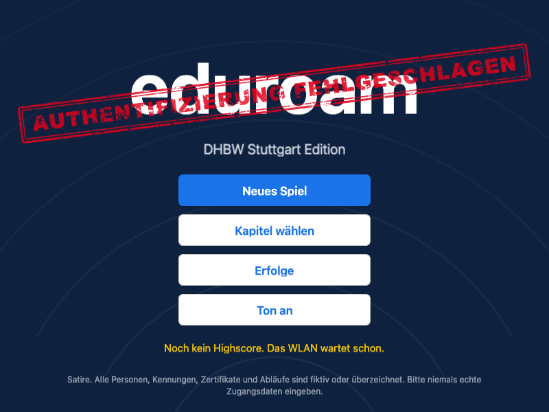
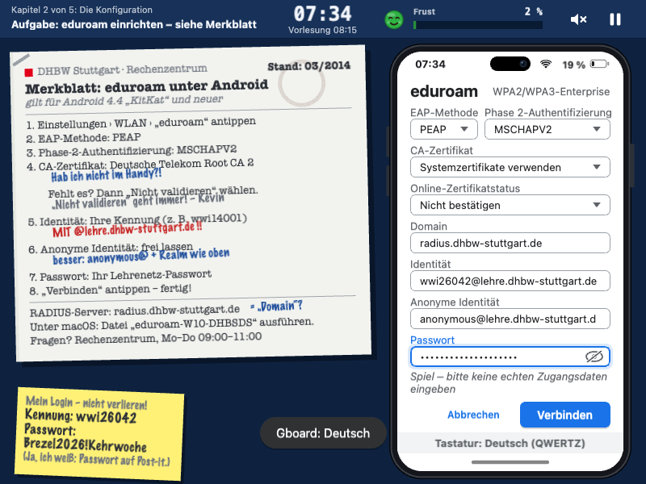
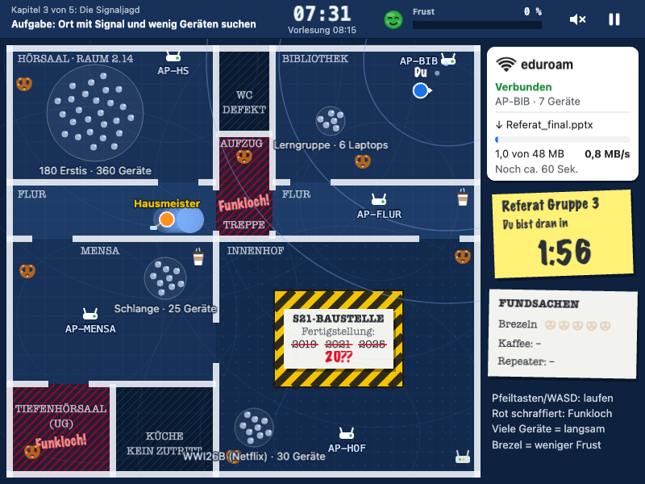
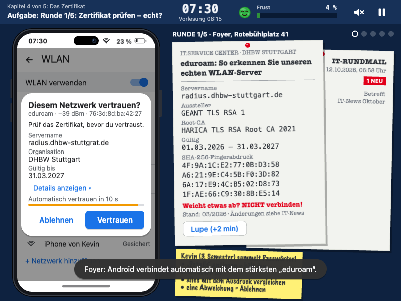

# eduroam – Authentifizierung fehlgeschlagen (DHBW Stuttgart Edition)

Ein satirisches Browserspiel, das spielbar macht, wie mühsam Registrierung und Login bei
eduroam sein können. Du bist Erstsemester an der DHBW Stuttgart, es ist 07:30 Uhr, um
08:15 beginnt die Vorlesung – und du brauchst nur „kurz“ WLAN.

**Spielen:** https://eduroam.felixkarg.de

## Die fünf Kapitel

1. **Die Registrierung** – Konto im Self-Service-Portal aktivieren
2. **Die Konfiguration** – das Handy mit eduroam verbinden, mit einem IT-Merkblatt von 2014
3. **Die Signaljagd** – über den Campus laufen und Empfang finden (Arcade)
4. **Das Zertifikat** – den Evil Twin enttarnen, bevor er dein Passwort bekommt
5. **Der IT-Helpdesk** – Endgegner mit Ticketsystem und Pop-up-Gewitter

Über alle Kapitel laufen eine Uhr und ein Frust-Meter. Bei 100 % Frust ist Schluss.
Highscore und Erfolge speichert der Browser.

## Screenshots

| Menü | Kapitel 2: Konfiguration |
|---|---|
|  |  |
| **Kapitel 3: Signaljagd** | **Kapitel 4: Zertifikat** |
|  |  |

## Lokal starten

- `index.html` doppelklicken – fertig. Ohne Internet lädt das Spiel Phaser aus `vendor/`.
- Oder über HTTP wie auf dem Server: `npm start` → http://localhost:2222

**Steuerung:** Maus und Tastatur; in Kapitel 3 Pfeiltasten oder WASD.

**Für Präsentationen** (URL-Parameter): `?unlock=all` schaltet alle Kapitel frei,
`?chapter=3` springt direkt in Kapitel 3, `?mute=1` schaltet den Ton aus.

## Hosting

Der Homeserver liefert das Spiel per Docker auf Port 2222 aus; Traefik und ein
Cloudflare Tunnel machen es unter `eduroam.felixkarg.de` erreichbar:

```bash
git clone https://github.com/kargfel/eduroam.git /opt/eduroam
cd /opt/eduroam
docker compose up -d --build     # Updates später: ./deploy/update.sh
```

Komplette Anleitung inklusive Variante ohne Docker, Traefik/Cloudflare-Abgleich und
Fehlersuche: [docs/DEPLOYMENT.md](docs/DEPLOYMENT.md).

## Entwicklung

- Phaser 3.90, klassische Scripts ohne Build-Schritt, keine externen Assets
- Architektur, Schnittstellen und Konventionen: [docs/ARCHITECTURE.md](docs/ARCHITECTURE.md)
- Recherche zu eduroam an der DHBW Stuttgart: [docs/RESEARCH.md](docs/RESEARCH.md)
- Tests: `npm install`, dann `npm test` (Unit-Tests mit `node --test`, Browser-Tests mit Playwright)

## Hinweis

Satire. Alle Personen, Kennungen, Zertifikate und Abläufe sind fiktiv oder überzeichnet.
Bitte im Spiel **niemals echte Zugangsdaten** eingeben. Wie es wirklich geht, steht am
Ende des Spiels.

Entstanden im Vibe-Coding-Workshop der DHBW („Neue Konzepte der Informatik“) mit
KI-Unterstützung (Claude). Phaser steht unter MIT-Lizenz, siehe `vendor/PHASER-LICENSE.md`.
